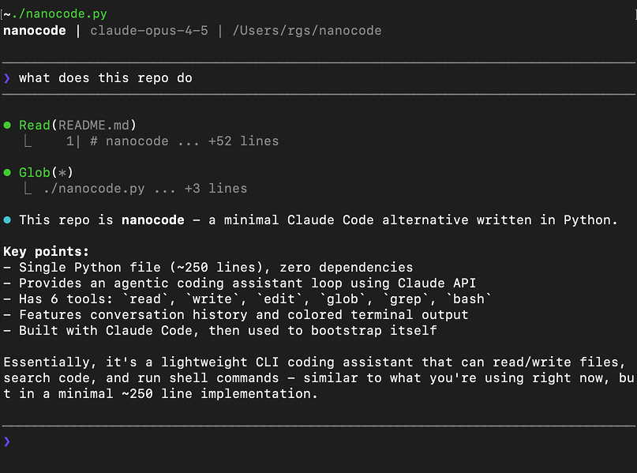

# nunnuncode

[🇬🇧 English](README.md) · [🇻🇳 Tiếng Việt](README_VI.md) · [🇩🇪 Deutsch](README_DE.md)

> A personal project for learning how coding agents work — built by reading code, then rewriting it from scratch.

Micro Coding Agent. Single Python file, zero dependencies.



## Why this project

This is my self-learning playground for **self-developed coding agents**. I started by studying how a minimal agent loop works — LLM + tools + history — and then rebuilt it line by line to really understand it. No frameworks, no dependencies, just the core mechanics.

## Features

- Full agent loop with one model-facing tool: `bash`
- Conversation history
- Colored terminal output
- Single file, zero dependencies

## Usage

```bash
export ANTHROPIC_API_KEY="your-key"
python nunnuncode.py
```

### OpenRouter

Use [OpenRouter](https://openrouter.ai) to access any model:

```bash
export OPENROUTER_API_KEY="your-key"
python nunnuncode.py
```

To use a different model:

```bash
export OPENROUTER_API_KEY="your-key"
export MODEL="openai/gpt-5.2"
python nunnuncode.py
```

### Custom OpenAI-compatible provider

Works with any OpenAI-compatible endpoint (your company LLM gateway, Ollama, vLLM, LM Studio, ...):

```bash
export API_BASE_URL="https://api.siemens.com/llm/v1"
export API_KEY="your-key"
export MODEL="your-model-name"
python nunnuncode.py
```

- `API_BASE_URL` — base URL up to `/v1`; nunnuncode appends `/chat/completions`
- `API_KEY` — sent as `Authorization: Bearer` (omit for local servers without auth)
- `MODEL` — required when using `API_BASE_URL`

### Tests

```bash
python -m unittest discover tests
```

## Commands

| Command | Description |
|---------|-------------|
| `/c` | Clear conversation |
| `/q` or `exit` | Quit |

## Tool

| Tool | Description |
|------|-------------|
| `bash` | Run a shell command |

## Example

```
────────────────────────────────────────
❯ say hello
────────────────────────────────────────

⏺ Bash(echo hello)
  ⎿  hello

⏺ Hello!
```

## Learning notes

Things I learned while building this:

- **The agent loop is just a while loop**: send messages → LLM replies with tool calls → run tools → send results back → repeat until no tool calls.
- **The model sees a tool schema, not its Python implementation**: this agent exposes only one schema, for `bash`.

## Roadmap

Keep the agent in one Python file with one model-facing tool: `bash`. Future changes are limited to correctness and portability of the agent loop and shell execution; adding more tools or feature subsystems is not planned.

## Credits

Based on [nanocode](https://github.com/1rgs/nanocode) by [1rgs](https://github.com/1rgs).

## License

MIT
