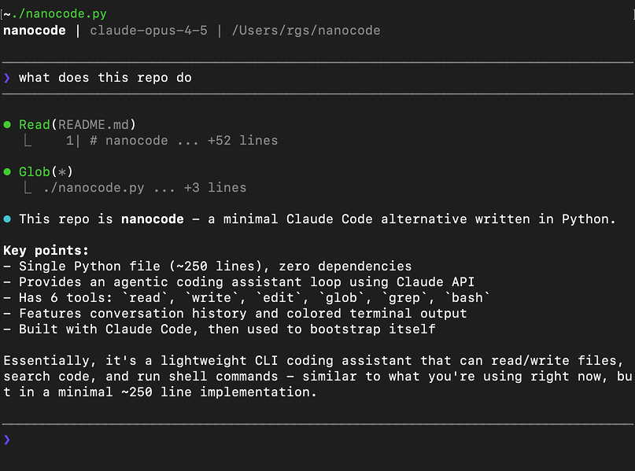

# nunnuncode

[🇬🇧 English](README.md) · [🇻🇳 Tiếng Việt](README_VI.md) · [🇩🇪 Deutsch](README_DE.md)

> Ein persönliches Projekt, um zu lernen, wie Coding-Agenten funktionieren — vom Code lesen bis zum eigenen Nachbau von Grund auf.

Micro Coding Agent. Eine einzige Python-Datei, null Abhängigkeiten.



## Warum dieses Projekt

Dies ist mein Lern-Sandkasten für **selbstentwickelte Coding-Agenten**. Ich habe damit begonnen zu studieren, wie eine minimale Agenten-Schleife funktioniert — LLM + Tools + Historie — und habe sie dann zeilenweise neu gebaut, um sie wirklich zu verstehen. Kein Framework, keine Abhängigkeiten, nur die Kernmechanik.

## Funktionen

- Vollständige Agenten-Schleife mit genau einem Tool: `bash`
- Konversationshistorie
- Farbige Terminal-Ausgabe
- Eine Datei, null Abhängigkeiten

## Verwendung

```bash
export ANTHROPIC_API_KEY="your-key"
python nunnuncode.py
```

### OpenRouter

Benutze [OpenRouter](https://openrouter.ai), um auf jedes Modell zuzugreifen:

```bash
export OPENROUTER_API_KEY="your-key"
python nunnuncode.py
```

Anderes Modell verwenden:

```bash
export OPENROUTER_API_KEY="your-key"
export MODEL="openai/gpt-5.2"
python nunnuncode.py
```

### Eigener OpenAI-kompatibler Provider

Funktioniert mit jedem OpenAI-kompatiblen Endpoint (Unternehmens-LLM-Gateway, Ollama, vLLM, LM Studio, ...):

```bash
export API_BASE_URL="https://api.siemens.com/llm/v1"
export API_KEY="your-key"
export MODEL="your-model-name"
python nunnuncode.py
```

- `API_BASE_URL` — Basis-URL bis `/v1`; nunnuncode hängt `/chat/completions` an
- `API_KEY` — wird als `Authorization: Bearer` gesendet (für lokale Server ohne Auth weglassen)
- `MODEL` — erforderlich, wenn `API_BASE_URL` gesetzt ist

### Tests

```bash
python -m unittest discover tests
```

## Befehle

| Befehl | Beschreibung |
|--------|--------------|
| `/c` | Gespräch leeren |
| `/q` oder `exit` | Beenden |

## Tool

| Tool | Beschreibung |
|------|--------------|
| `bash` | Shell-Befehl ausführen |

## Beispiel

```
────────────────────────────────────────
❯ sag hallo
────────────────────────────────────────

⏺ Bash(echo hello)
  ⎿  hello

⏺ Hallo!
```

## Lernnotizen

Was ich beim Bauen gelernt habe:

- **Die Agenten-Schleife ist einfach eine while-Schleife**: Nachrichten senden → LLM antwortet mit Tool-Calls → Tools ausführen → Ergebnisse zurücksenden → wiederholen, bis keine Tool-Calls mehr kommen.
- **Das Modell sieht ein Tool-Schema, nicht die Python-Implementierung**: Dieser Agent stellt nur ein Schema für `bash` bereit.

## Ausblick

Der Agent bleibt in einer Python-Datei mit genau einem modellseitigen Tool: `bash`. Künftige Änderungen beschränken sich auf Korrektheit und Portabilität der Agenten-Schleife und der Shell-Ausführung. Weitere Tools oder Funktionsbereiche sind nicht geplant.

## Danksagung

Basierend auf [nanocode](https://github.com/1rgs/nanocode) von [1rgs](https://github.com/1rgs).

## Lizenz

MIT
